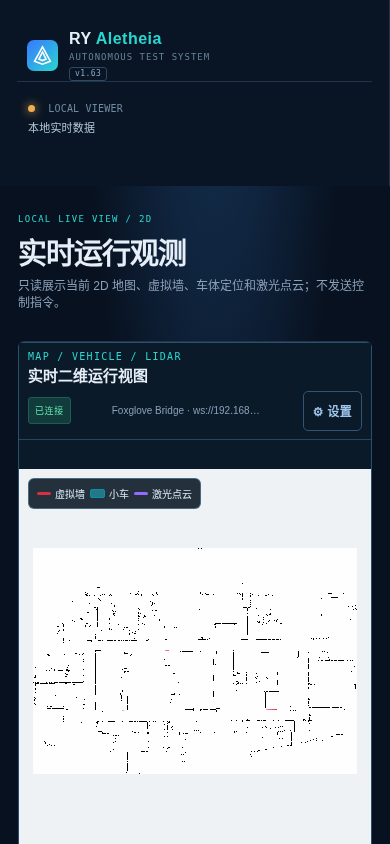
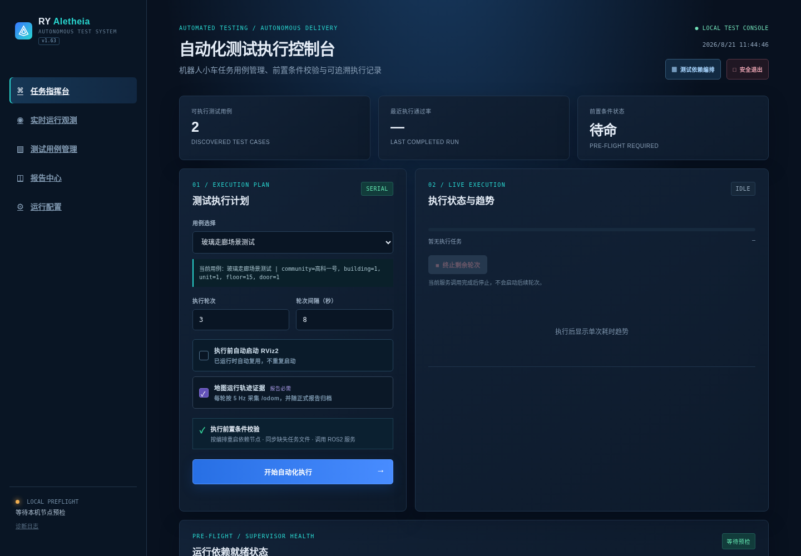
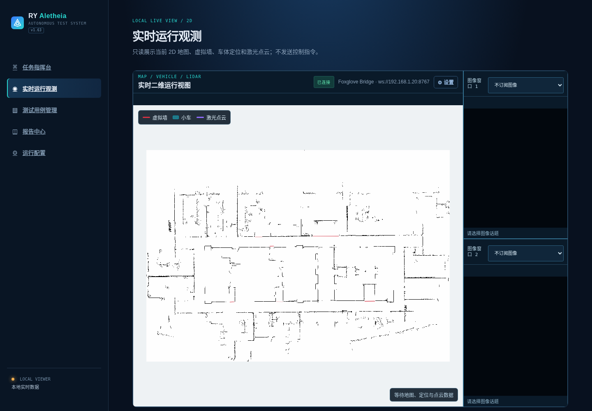
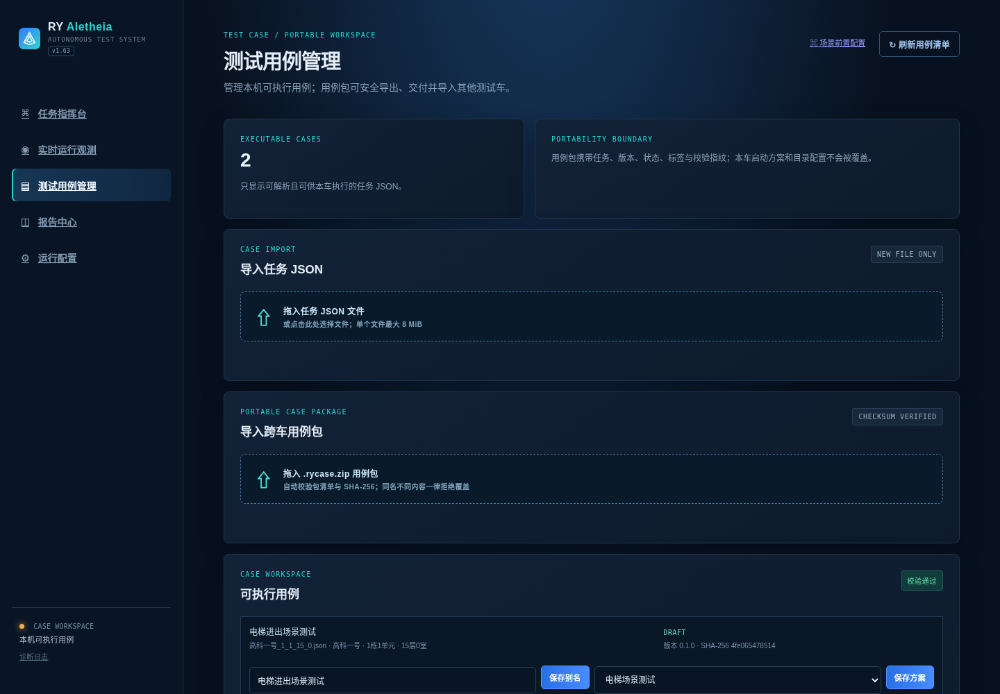
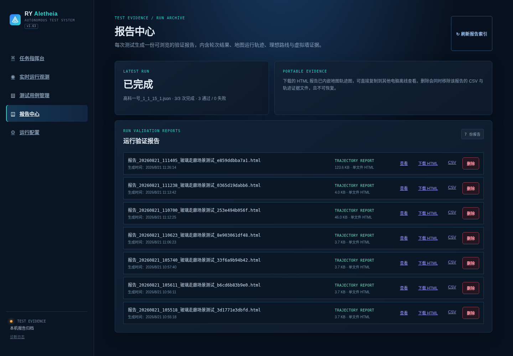
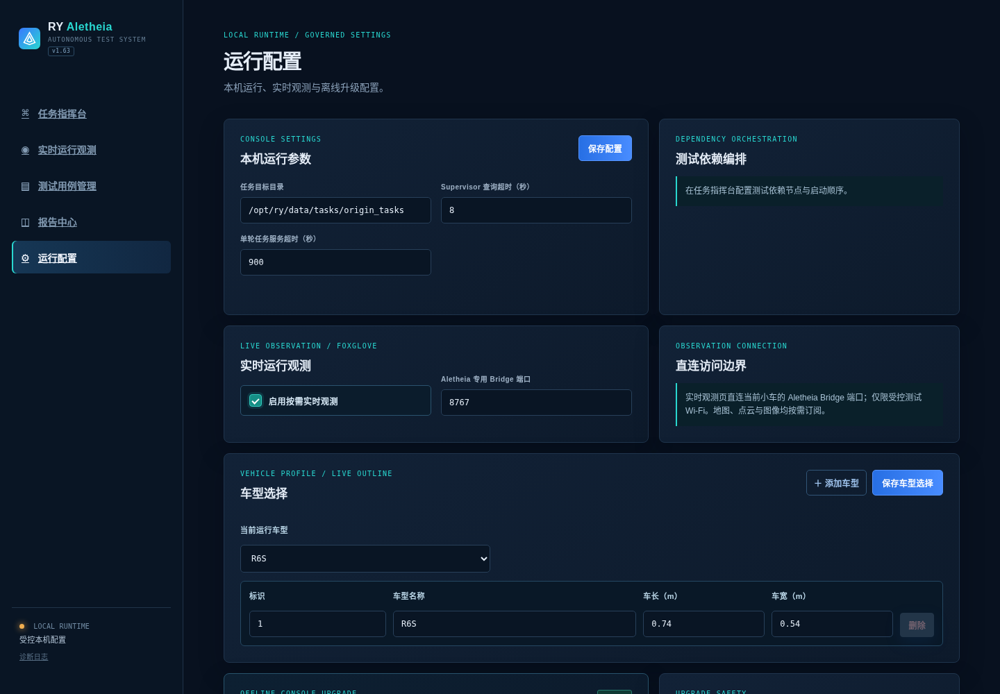
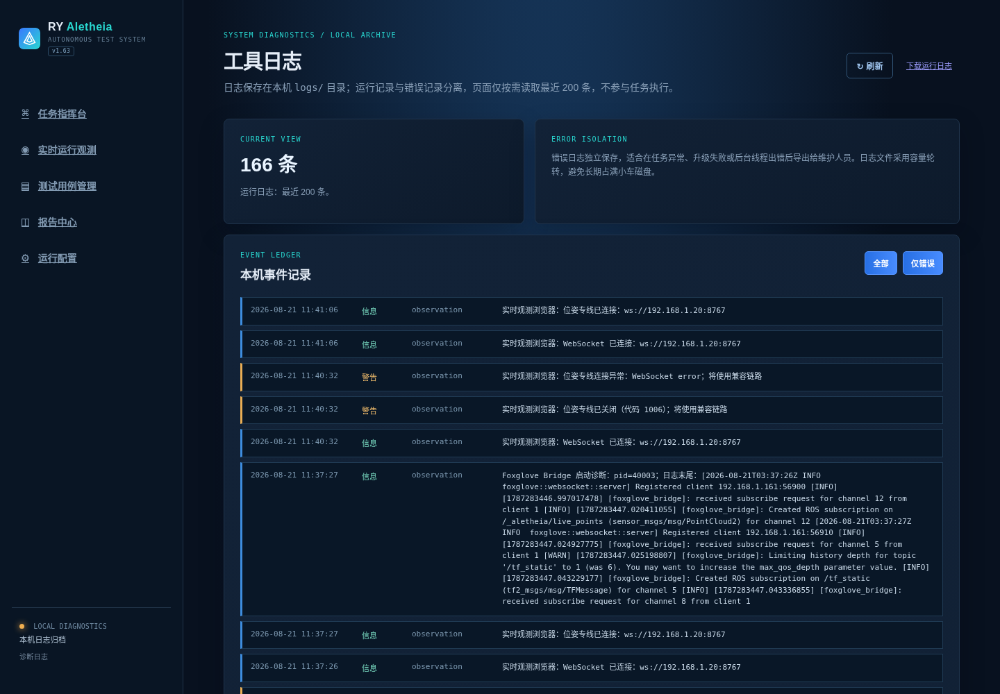
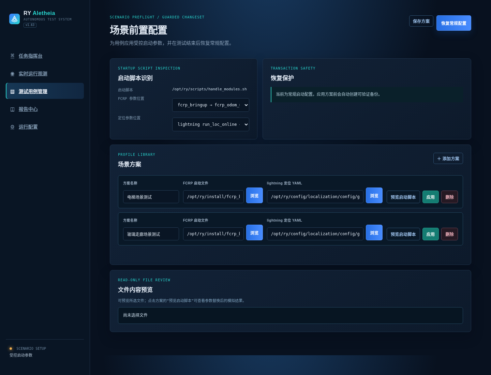

# RY Aletheia 用户操作指南

RY Aletheia 用于机器人小车自动测试：管理测试用例、按规则恢复运行依赖、执行多轮任务、记录轨迹，并生成测试报告。

工具运行在小车本机。测试电脑只需连接小车 Wi-Fi，再通过浏览器访问小车页面；正常使用不需要互联网、不需要手动执行 ROS2 命令，也不需要理解工具源码。

> 本文面向测试人员与部署人员，提供安装、配置、执行、观测、升级与排障的完整图文步骤。项目简介与代码入口见 [README.md](README.md)；开发、构建和系统维护说明见 [PROJECT_OVERVIEW.md](PROJECT_OVERVIEW.md)。

## 目录

- [1. 安装前准备](#1-安装前准备)
- [2. 首次安装](#2-首次安装)
  - [工具数据目录说明](#工具数据目录说明)
- [3. 启动、访问与停止](#3-启动访问与停止)
  - [手机与平板访问](#手机与平板访问)
- [4. 界面导览：先认识主要功能页](#4-界面导览先认识主要功能页)
  - [任务指挥台](#41-任务指挥台从这里开始执行测试)
  - [实时运行观测](#42-实时运行观测地图视频与受控操作)
  - [测试用例管理](#43-测试用例管理导入校验与交付)
  - [报告中心](#44-报告中心查看和导出报告)
  - [运行配置](#45-运行配置只在需要时调整)
  - [工具日志](#46-工具日志异常时导出给维护人员)
  - [手动控制](#48-手动控制接管与停止)
  - [诊断录包](#49-诊断录包手动场景与测试轮次)
- [5. 第一次使用前配置](#5-第一次使用前配置)
- [6. 执行一次测试](#6-执行一次测试)
- [7. 停滞、失败与人工恢复](#7-停滞失败与人工恢复)
- [8. 报告与轨迹](#8-报告与轨迹)
- [9. 工具升级](#9-工具升级)
- [9.1 ShmSDK 视频试运行的回退](#91-shmsdk-视频发布包的回退)
- [10. 卸载](#10-卸载)
- [11. 常见问题](#11-常见问题)

## 1. 安装前准备

请确认：

- 小车已正常启动，自动驾驶软件和 Supervisor 可用。
- 安装操作使用具有 `sudo` 权限的账户；工具实际运行使用普通账户（通常是 `ry`）。
- 已取得对应版本的 `ry-aletheia_<版本号>_ros_amd64.deb` 或 `_shm_amd64.deb` 完整离线首次安装包。
- 测试电脑与小车连接同一 Wi-Fi，并知道小车 IP 地址。

工具默认不启用开机自启。需要时可在“运行配置”打开“开机自启 · 用户登录后运行”；它只为当前普通用户创建 `systemd --user` 服务（不可用时回退到 XDG 桌面自启），不会启动、停止或修改机器人已有 ROS/Supervisor 节点，也不会以 root 运行控制台。

## 2. 首次安装

将对应车辆视频输入配置的 `.deb` 文件复制到小车任意目录，例如“下载”目录。以下以 ROS 相机包为例，ShmSDK 车辆请使用维护人员提供的 `_shm_amd64.deb` 文件名：

```bash
cd <安装包所在目录>
sudo dpkg -i ./ry-aletheia_<版本号>_ros_amd64.deb
```

完整离线 DEB 不声明或携带额外的 GStreamer/VAAPI/MediaMTX 依赖目录和静态库；受控视频运行时已内嵌在工具二进制中，首次启用视频时由工具写入用户目录。实时点云和位姿使用工具自身的轻量遥测网关，不依赖通用 ROS-Web Bridge。推荐始终使用 `dpkg -i` 安装。安装过程不会在小车上执行 `apt install`。请勿对完整包执行 `apt autoremove`；如 `dpkg` 提示该 DEB 自身缺少依赖，再将完整错误信息提供给维护人员。

安装程序会自动：

- 识别小车普通运行账户，并部署到 `/home/<普通账户>/ry_aletheia/`；
- 配置测试编排访问小车既有 Supervisor 所需的受限权限；
- 创建任务、配置、报告、地图缓存和升级目录；
- 安装可选的 `ry-aletheia-video` 维护命令，不创建视频 Supervisor 或 systemd 服务；
- 保留小车原有自动驾驶软件，不替换其 ROS2、导航、定位或 Supervisor 配置；
- 默认保持工具停止且不设置开机自启；是否启用由“运行配置”中的用户级开关决定。

安装成功后，终端会显示启动命令：`ry-aletheia`。

### 工具数据目录说明

工具安装在 `/home/<普通账户>/ry_aletheia/`。日常使用时只需要关注以下数据目录；通过网页完成操作优先于直接修改文件。

| 目录 | 保存内容 | 使用说明 |
| --- | --- | --- |
| `tasks/` | 已导入的测试任务 JSON | 可从“测试用例管理”导入；也可在未执行测试时复制任务文件到此处。不要覆盖已有同名任务。 |
| `config/` | 运行配置、车型、依赖编排、场景方案和用例信息 | 由网页自动维护。不要手动编辑或删除，以免配置不一致。 |
| `reports/` | 已完成测试的 HTML/CSV 报告和轨迹证据 | 可在“报告中心”查看、下载或删除；建议定期导出需要长期保存的报告。 |
| `maps_cache/` | 地图、虚拟墙与实时观测所需的缓存 | 由工具自动更新。地图显示异常时请先联系维护人员，勿在测试中手动删除。 |
| `updates/` | 升级 ZIP 暂存文件及当前版本的唯一备份 | 由离线升级流程管理；不要手动清理正在升级或用于回退的文件。 |
| `runtime/video/` | 工具首次启用视频时从二进制内嵌负载刷新的私有运行时 | 不要手动复制系统视频库到此处；DEB 不单独携带这套依赖。 |
| `logs/` | 工具、实时观测和错误诊断日志 | 页面出现异常时，从“工具日志”导出诊断信息提供给维护人员。 |

除非维护人员明确要求，请不要删除整个 `ry_aletheia/` 目录，也不要改动其中的程序文件。任务、配置和报告需要备份时，优先通过网页导出；手动备份时仅复制上述数据目录，且必须在没有执行中测试、升级或人工恢复流程时进行。

## 3. 启动、访问与停止

### 启动工具

在小车普通账户的终端执行：

```bash
ry-aletheia
```

工具会自动加载小车 ROS2 运行环境。请不要使用 `sudo ry-aletheia`，也不要使用 `sudo ./dist/ry-aletheia`。

启动后，测试电脑在浏览器打开：

```text
http://<小车IP>:8087
```

例如：`http://192.168.1.20:8087`。

如果浏览器无法访问，请先确认电脑和小车在同一 Wi-Fi，再确认 IP 地址无误。

### 手机与平板访问

手机、平板和电脑使用同一个访问地址。系统会自动为手机和平板打开移动端界面，电脑端仍保持原有桌面布局不变；如需临时切回电脑布局，可在移动端菜单中选择“使用桌面版”。

移动端的所有页面和功能与电脑端一致，只是导航与表单会改为更适合触控的布局。实时运行观测具有独立的横竖屏控制台：地图与相机使用底部导航切换，横屏、竖屏以及浏览器地址栏常驻时都可使用；全屏按钮只改变显示方式，不会向小车发送控制指令。



手机上可直接使用竖屏观察地图或相机，持续观察多路视频时横屏空间更充足。页面本身禁止双指缩放，防止误操作把整个控制台缩小；在地图区域内仍可单指拖动、双指缩放和平移。小屏幕上连接地址可能会缩略显示，这是正常的界面适配，连接状态以绿色“已连接”标识为准。

### 停止工具

优先在网页右上角点击“安全退出”。确认页面提示已退出后，8087 端口会停止监听。

也可以回到启动工具的终端按 `Ctrl+C` 结束。关闭浏览器不会停止工具。

如果提示端口 `8087` 已被占用，通常表示工具已经在运行；不要重复启动，直接访问网页或使用“安全退出”。

### 查看资源占用

在小车终端执行：

```bash
ry-aletheia-status
```

它每秒显示一次工具的 CPU、内存、线程数和运行时长。`工具总 CPU` 按控制台服务及其全部受控子进程采样，包含原生点云/位姿预处理器、MediaMTX 与已启用的视频编码器；不会把小车原有 ROS 驱动、导航和自动驾驶进程算入。按 `Ctrl+C` 退出查看；该命令不会额外启动常驻监控进程。

## 4. 界面导览：先认识主要功能页

打开首页后，左侧导航可进入以下页面。首次使用建议按“运行配置 → 测试用例管理 → 任务指挥台 → 报告中心”的顺序熟悉；实时运行观测可在测试前后随时打开查看。

| 页面 | 用途 | 什么时候使用 |
| --- | --- | --- |
| **任务指挥台** | 选择用例、设置轮次、查看预检和执行进度 | 每次启动自动化测试时使用。 |
| **实时运行观测** | 查看地图、车体、虚拟墙、点云和视频 | 普通观测只读；PC 手动重定位与标记点导航需显式确认。 |
| **测试用例管理** | 导入、校验、命名、导出或归档测试用例 | 新增、交付或整理任务 JSON 时使用。 |
| **报告中心** | 查看、下载和删除已完成测试的报告与轨迹 | 一轮或一批测试完成后使用。 |
| **运行配置** | 配置实时观测、车型、依赖编排和离线升级 | 首次使用、小车软件环境变更或升级工具时使用。 |
| **工具日志** | 导出运行和错误诊断信息 | 页面异常、升级失败或需要维护支持时使用。 |

### 4.1 任务指挥台：从这里开始执行测试



任务指挥台是日常测试的主页面。顶部卡片显示当前已发现用例、最近结果与预检状态；中部“测试执行计划”用于选择任务、设置轮次和间隔；下方依次显示依赖节点状态、执行进度与每轮记录。

使用步骤：

1. 在“用例选择”中选中本次要执行的任务，并核对下方场景信息。
2. 设置执行轮次和轮次间隔。首次验证建议先执行 1 轮，确认现场与依赖恢复流程无误后再增加轮次。
3. 地图运行轨迹证据为正式报告必需项；每轮会按既有频率采集并归档。
4. 阅读“执行前置条件校验”区域。只有全部条件满足后，才点击“开始自动化执行”。
5. 执行中通过“执行状态与趋势”“本轮线路进度”“执行记录”查看状态；不要通过刷新页面或重复点击开始按钮干预运行。

开始前请确认页面没有红色预检提示，车辆周围安全、急停状态正确，并由现场人员确认车辆可以自主运动。

### 4.2 实时运行观测：地图、视频与受控操作



地图、位姿和点云默认只读观测；PC 的手动重定位由操作者显式启动并通过 Backend 受控执行。PC 地图依次叠加底图、米制格栅、局部代价地图、虚拟墙、规划路线、地图标记、点云和按当前车型绘制的车体；不保留与 WebRTC 重复的图像订阅窗。顶部绿色“已连接”表示专用实时遥测已连接，状态栏会显示地图、定位和点云的等待或接收情况。

PC 的“规划路线”图层显示小车 `/plan` 发布的实际导航路线，普通配送、自动测试和前往标记点均可显示。导航执行中保留最近路线，即使长路线只发布一次也不会按 5 秒超时隐藏；完成、取消、失败、切图或读取中断后清除。图层开关只控制显示。须有对应 Nav2 导航状态；页面打开前已发布且不再更新的 Volatile 路径不能补读历史。

PC 可用“添加标记”在当前地图放置位置与朝向并保存名称，点击已有标记可删除或确认“前往”。前往会实际创建导航目标，要求当前地图一致、定位与急停正常、已确认自动驾驶控制源，且没有测试、手动驾驶或手动重定位占用；它不会切图或跨楼层。执行中可请求取消，须等车端终态确认，不能把点击取消当作已停止。关闭页面不会代替取消操作。

PC 地图中点击“手动重定位”即可拖动车体预览位置，右键拖动调整朝向；定位异常、自动重定位卡住或接口暂不可用均不阻止本地预览。找不到图标时点“一键找回车体”，预览跟随鼠标，点击落位，按住拖动可设置朝向；Esc 或“取消预览”只取消预览，不切换车辆控制。落位后点“确认重定位”，工具自动请求并确认车辆停车，再调用重定位；无需先点其他开始或重新对齐按钮。执行失败保留已调整的位置，修改后可再次确认；恢复自动驾驶为单独的显式操作。定位配置默认“自动 · 沿用当前配置”；需要兜底时，切为“手动选择定位 YAML”，从小车的 `/opt/ry/config/localization` 浏览子目录并选择配置。手选会加载整份配置，提交前请核对面板中的文件；允许选择其他地图的定位配置，用于定位重启后切回正确的定位地图；请按所选地图坐标拖拽对齐。工具读取配置中的 system.map_path，使用该目录下的 map.yaml 并行切换二维地图与初始化定位；两项都确认成功后才恢复自动驾驶。任一项失败保持停车，二维地图可能已经切换，请按现场状态处理。文件不会被修改或复制，选择仅用于本次，本次成功并交接实时位姿、或取消预览后恢复默认自动。

已由维护人员启用工业相机配置时，页面下方会自动出现 0–6 张“低延迟相机流”卡片。它们通过 WebRTC 直接从小车的私有 MediaMTX 获取 H.264 视频，不占用点云或位姿遥测链路，也不会向小车发送控制指令。卡片显示“等待相机”表示编码器尚未收到输入。目标检测和分割始终检查 ROS 图像；前、后、左、右物理相机则取决于维护人员提供的发布包：`_ros` 包检查 ROS 图像，`_shm` 包检查对应 `Cam*` 通道。两种情况都不要因此重启原相机节点或修改 `mempool`；先进入“工具日志”导出诊断信息给维护人员。

使用步骤：

1. 首先在“运行配置”中启用“按需实时观测”，再进入本页。
2. 等待地图加载。车体和点云出现前，右下角会显示“等待地图、定位与点云数据”；这表示页面正在等待上游数据，并不代表工具向车辆发出了指令。
3. 通过不同图形和颜色区分虚拟墙、点云与车体；车体按当前车型的米制尺寸绘制，左下或右下比例尺标明当前米制格栅距离。
4. WebRTC 相机默认关闭。首次开通由维护人员核对相机话题、`/dev/dri/renderD128` 权限、`ros_domain_id` 和现场网络后，日常只需在本页“低延迟相机流”右上角点击“启用视频/关闭视频”。首次启用会自动选中当前已验证的相机流；之后若维护人员只保留部分相机，页面会保留该选择。关闭会立即回收本工具的 MediaMTX 与视频旁路进程，避免占用编码与网络资源；不会操作车辆节点。`ry-aletheia-video` 仅用于维护排障。

若页面持续只有地图或持续显示等待数据，请刷新本页一次并等待约 10 秒；仍不能恢复时进入“工具日志”导出诊断信息，不要在运行中的测试中手动重启车辆节点。

### 4.3 测试用例管理：导入、校验与交付



测试用例管理用于维护本车可执行任务。页面上方区分普通任务 JSON 与跨车 `.rycase.zip` 用例包；下方每张用例卡片显示任务来源、场景信息、校验结果、别名、绑定的场景方案及交付状态。

使用步骤：

1. 导入本车任务时，把 JSON 拖入“导入任务 JSON”区域，等待页面完成校验。
2. 从其他测试车接收标准化任务时，拖入 `.rycase.zip`。系统会核对包清单和 SHA-256，拒绝同名但内容不同的文件，避免误覆盖。
3. 在“可执行用例”卡片中填写便于识别的场景别名；需要特定定位或启动参数时，选择相应场景前置方案并保存。
4. 仅在用例已通过实车验证后，再通过“用例管理与交付”填写版本、状态、标签和说明并导出。

导入成功不等同于实车通过。页面的“校验通过”只表示文件结构可解析；仍应先执行低风险单轮测试验证现场条件。

### 4.4 报告中心：查看和导出报告



每次已完成的测试计划或部署验收计划都会生成一份报告。列表会明确标记“自动测试”或“部署验收”，并分别提供“预览”“下载 HTML”“CSV”和“删除”。HTML 报告已内嵌地图轨迹图、执行时间与结果证据，复制到其他电脑后可离线浏览；CSV 适合做统计或导入其他分析工具。打开报告中的轨迹图后，将鼠标移到蓝色实际轨迹附近，游标会磁吸最近采样点，卡片固定显示在该点上方，内容包括北京时间、路线标识、X/Y 坐标和采样序号；报告不再显示容易误解的“偏差”字段。

使用步骤：

1. 测试完成后点击“刷新报告索引”，确认新报告已出现在列表中。
2. 先点击“预览”核对用例或验收任务、执行时间、结果、轨迹、理想路线和虚拟墙证据；抽样验收的结论只代表本次冻结样本。
3. 需要归档或交付时下载 HTML；需要进一步统计时下载 CSV。
4. 仅在报告已完成外部备份且确认无保留价值时再点击“删除”。删除会同时移除对应 CSV 与该报告专属轨迹证据，无法恢复。

部署项目中的地图阶段也在 PC 部署工作台内配置：先添加需要的“户外图”“摆渡层”“室内大厅”“用户楼层”卡片，再拖动卡片调整顺序。四类阶段均可单独使用，不要求额外添加用户楼层或大厅；组合多图时，如有用户楼层则放在最后。拖动到卡片前方、后方或两个卡片之间时，蓝色插入指示会自动吸附到可放置位置；松开后保存流程。摆渡层可按现场实际需要重复添加。项目列表中的删除按钮会要求确认，删除项目快照及其地图/导出文件，不能恢复。

单图场景仍需在图上放置起点、目标并保存任务线路。单任务模式导出完整往返任务；多任务模式只导出所选阶段的去返文件，不补造其他地图或乘梯动作。独立用户楼层可为不同送货目标保存各自线路，同图取送货不要求标记电梯，但多任务门牌命名仍须填写有效目标门牌。缺少任务线路字段的历史单图项目会保留地图和标记，首次使用时请明确保存线路后重新生成预览。实验包通过预览不代表已安装或已完成实车验证。

没有已保存线路时，编辑器默认就是新线路草稿，配置完成后直接点“保存新线路”即可。已有线路配置好另一套流程后，可点“新建线路”保留名称、起点、步骤和动作，转成新草稿再保存，原线路不会被覆盖；需要清空草稿时点“放弃修改”。导出的行为树文件名、`waypoint_task_id` 和 `waypoint_id` 使用 ASCII；全中文线路名会对应 `line_01` 等简短后缀。界面名称与中文标签仍保留，已有旧导出不会自动改名，需重新生成预览和下载。

只有 PCD 点云时，在原“现场实施向导”的地图来源中选择“PCD 生成二维地图”。上传后等待高度分析，选择候选地面或手动调整截取高度上下限，按需选择去噪并生成预览。地图分辨率默认 0.05 米/格，可按需调整；默认保留单点细节，不要求填写邻居数。高度使用点云坐标系的绝对 Z 值，不能直接把雷达安装高度当作地面高度。候选只作参考，多楼层和坡地须特别核对。

二维预览采用黑白显示：黑色为障碍，白色合并显示其他区域，便于检查墙体、门洞和通道；白色不代表已确认可通行，保存的地图仍保留未知区域。预览内可用滚轮缩放、拖动平移，点击悬浮工具中的“适配”复位。缩小时仍保留细墙的障碍证据；预览点半径默认 0.5 像素，可调整显示大小，仅影响预览，不扩大导出 PGM 的障碍范围。可选叠加同坐标系的轨迹 PCD，支持显示、隐藏及移除，仅供检查，不写入地图；刷新页面后需重新选择轨迹文件。缩放工具与“查看源 PCD”入口均为预览窗口内的半透明组件，点击入口在同一窗口切换到三维只读视图，可旋转、缩放、平移、俯视并显示当前选定截面；调整高度时截面同步更新，点击“返回二维地图”保留此前的二维缩放和平移位置；源点云显示全部有效点并注明点数，不再做二次抽稀，转换也使用完整点云。填写地图名称后确认导入，随后按原向导继续地图阶段、楼栋单元和标记操作。参数变动后需要重新生成预览才能确认；切换页面或刷新不会取消后台处理，返回原项目即可查看状态。原 PCD 保留，二维图与参数只保存到部署项目，不自动替换车辆运行地图。已有 YAML/PGM 的地图仍可按原方式导入，`index.txt` 为可选兼容文件。

源点云采用深色画布与细点显示；文件带原始颜色时默认保留原色，没有颜色时默认按高度着色。在窗口内打开“显示设置”，可选择文件支持的原始颜色、强度或高度，调整点大小；查看始终使用全部有效点，不再提供抽样模式。右上角“全屏查看”可直接放大当前窗口，保留观察角度与缩放；点击“退出全屏”或按 Esc 返回。浏览器不允许原生全屏时，自动放大为页面内窗口。显示点数始终注明；二维转换使用全部有效点。截面默认隐藏，可随时打开；下限用青色实线、上限用金色虚线，上下限由四条竖向边连接，围成淡紫色的透明三维截取区域。区域以 28% 不透明度绘制，不遮挡前方点云，不改变源点颜色；缩放时边界线宽保持清晰。窗口内显示对应的上下限高度；调整有效高度范围时同步更新，不改变点云着色设置或投影参数。首次查看完整点云需要后台准备，准备期间可继续操作部署向导。旧抽样缓存会自动重新生成，无须重新上传；完整显示的加载时间和交互速度取决于点云大小、网络及浏览器显卡。

分辨率由实施人员设置，默认 0.05 米/格。工具保留全图 XY 范围和当前截面内的单点细节，不会静默改动分辨率、截取高度或裁剪点云。若完整栅格超过 1600 万格或单边 16384 格，会明确提示原因并给出建议分辨率，由你调整后重新生成；已有成功预览保持其实际参数。预览窗口显示当前转换阶段和进度，百分比反映处理阶段，不是剩余时间估算；失败原因直接显示在窗口内。

地图工具收在画布左上角的半透明工具条中：选择与平移、添加组件、虚拟墙、橡皮擦、框选擦除和适配视图。点击“添加组件”展开导航标记及设施面板；选择后自动收起，鼠标移动时显示半透明位置预览，点击地图内落位后回到选择模式。组件仍可左键拖动、右键编辑属性；地图外点击不会提交新组件。按 Esc 或点击浮层取消按钮可退出当前工具，空格可临时平移。切换工具会取消未保存的墙线、框选或笔刷草稿，已保存记录保留。组件面板内按 Esc 先收起面板，键盘焦点回到“添加组件”。擦除时按需显示尺寸、形状、撤销与清空操作；框选可用 Enter 完成。编辑快捷键仅在地图工作区生效，按钮、输入框和只读任务预览不触发地图保存或删除。

地图标记画布右上角可切换“美化 / 原始”。美化在后台整理灰白碎纹，并连接有两侧墙体支持的短墙缝（最长约 0.3 米）。对于稀疏、轻微错位的近水平/垂直墙线，会核对两侧约 1.2 米范围内的原始墙体支撑，补齐不超过约 0.65 米的短缺口；成对门框、连续白色穿行区域和透明裁剪断层保留开口，不使用新补点继续推断墙体。较长的水平/垂直墙体断点，在原始墙线支持充分且未识别为门洞时，可补齐至 2 米。默认保留每一个原有障碍点，包括孤立小特征。缩小时仍让每个障碍特征参与绘制，避免细墙被采样漏掉。地图标记阶段不再提供清理孤立点、查看改动或手动保护控件；特征保留自动生效。新建 PCD 转换默认开启孤立格清理，仅处理八邻域内没有其他障碍格的孤立格，保留连续墙线与细小结构；可在转换步骤关闭后对照预览，已有会话保留其显式参数。被清理的格仍保存为未知。

区域整理以墙体和连通性为约束：按原始非障碍格栅统计趋于围合区域内的灰白比例，未知格占比 ≥50% 时，将区域底色统一为未知灰色，原有障碍特征保留；不按整张地图的灰白比例判断。未知不足 50% 时，不会仅因白色观测稀疏、被未知包围或形状像房间而整体归灰。门洞可作为分区边界参与判断，不代表把门洞画成墙。双侧有墙支撑、至少 80% 来自真实白色观测的独立细长走廊予以保留。其余已有观测区域中的小型未知孔洞可填为纯白；白色不会直接穿过墙体传播，大块未知区域不会整体填白。若导入的二值图已丢失未知值，无法从中恢复原始未知占比。

需要明确通行空间时，可用虚拟墙手动封住实体墙的缺口。保存后的虚拟墙与实体墙共同参与美化层的连通性判断：优先保留当前地图起点所在区域，起点落在未知格时寻找附近可达的观测区域；未设置可用起点时，综合观测面积与实体墙、已保存虚拟墙对边界的支撑程度选择主通行区，避免稍大的外部白块抢占已围合的大厅，也避免优先选中很小的封闭碎区。未知区域不会作为通道，让房间绕过虚拟墙重新连接走廊。分析时对墙线微小断点和虚拟墙端点使用约 0.1 米半径的容差，粗分辨率无法表示该尺度时跳过容差扩张；这些分析边界不会写入物理障碍。已围合的主通行空间将非障碍底色补成纯白，其他未保留的观测块填灰，原有障碍特征仍保留。这条人工封闭空间规则优先于上述自动未知比例判断。若通行空间尚有缺口连向图外或透明边界，不会将外部未知盲目填白。仍有真实观测通道连接走廊的房间，需继续用虚拟墙封住开口；算法不擅自抹掉这些连接。地图原点 `(0,0)` 标记不作为起点航点。

虚拟墙新建、移动、改形和删除保存后会重新计算底色；正在绘制或拖动的草稿不参与填色。“原始”视图与上一步二维预览一致，以纯黑显示原有障碍、纯白显示其他区域；只合并观看底色，不修改 PGM 的未知值，不叠加自动补墙或填灰结果。已保存的人工擦除、虚拟墙与标记仍显示。观看用 PNG 始终导出最新美化结果。自动判断属于观看效果，机器人地图、虚拟墙保存协议和既有导航包导出行为不变。

电梯入口等需要人工确认的局部残影，可用“橡皮擦”拖动清理，或用“框选擦除”逐点勾勒后点击“完成框选”。框选完成前，鼠标靠近顶点会出现高亮圆环与抓手光标，按住左键拖动可微调位置；点击空白处仍添加顶点。命中范围不随地图缩放而变小，相邻顶点优先选最近的一个。拖动不会新增顶点或提前保存；取消指针操作恢复该顶点原位置，切换地图取消未完成的框选。人工擦除在美化结果之上显示为纯白，不会被自动补缝或重新美化覆盖；可用“撤销擦除”逐次恢复。框选保存期间保持擦除预览，保存失败会保留选区，可直接重试。请保留真实门框、墙角和障碍；原始导入文件不会被擦除操作覆盖。

画布右上角的“导出图片”生成原始像素尺寸的美化 PNG，包含当前地图已保存的橡皮擦和框选擦除。图片不含图例、状态组件、编辑控件、原点标记、航点或路线；左下角不再显示图例组件。美化完成后才能导出；请先完成或取消尚未提交的擦除。

美化只生成浏览器显示图和观看用 PNG，观测区域的连续填色不表示可通行；自动补缝也不替代现场检查。自动美化不会改变原始 PGM/YAML、分辨率、坐标、导航配置及原有导航包导出，人工擦除仍沿用已有项目编辑层的保存与导出机制。大图处理中可继续缩放和平移，切图会取消旧处理；处理失败时退回原图，观看用 PNG 导出不可用。

### 4.5 运行配置：只在需要时调整



运行配置集中管理工具级设置：本机运行参数、测试依赖编排入口、实时观测开关、车型轮廓以及离线升级。日常执行同一类测试时一般不需要反复修改；只有首次启用实时观测、调整车型、变更依赖编排或安装升级 ZIP 时才进入此页。

使用步骤：

1. 修改任务目录或超时时间后，点击“保存配置”。除非已确认小车软件环境变化，否则不要任意缩短超时。
2. 需要实时观测时勾选“启用按需实时观测”。遥测端口由工具固定管理：浏览器使用 `8768`，小车本机点云/位姿预处理分别使用回环 `127.0.0.1:8769` / `127.0.0.1:8770`；页面不提供修改端口的入口。
3. 在“车型选择”中选择实际车型，或者添加车型后填写车长、车宽并保存。车体轮廓仅影响观测显示，不会改变车辆控制参数。
4. 需要调整节点启动顺序时，从任务指挥台的“测试依赖编排”进入配置；不要把无关节点加入编排。
5. 日常升级时先确认升级区显示“可升级”。如显示“已锁定”，请按卡片中的原因和入口先结束执行中的测试或恢复常规启动配置；完成后刷新页面再拖入维护人员提供的升级 ZIP，并点击“校验并应用升级”。

> 截图中的任务名称、车型、端口和版本号仅为界面示例，应以当前小车和当前页面显示的信息为准。

### 4.6 工具日志：异常时导出给维护人员



工具日志管理 Aletheia 自己的运行与错误记录，不参与任务执行。“本机事件记录”包含时间、级别、模块和事件内容，可切换“全部”和“仅错误”。上方可以逐文件下载，也可以下载错误日志或完整诊断 ZIP。

使用步骤：

1. 页面异常、升级失败、实时观测无数据或任务无法开始时，先点击“刷新”。
2. 选择“仅错误”，记录异常出现的大致时间、所在页面和看到的提示。
3. 点击“下载完整诊断包”，或下载对应链路的单个文件，将下载文件和上述现象一起提供给维护人员。

默认自动保留 7 天历史，日志总量预算为 256 MiB，原始日志单文件上限为 16 MiB。在“存储与保留”中可以调整并点击“保存并整理”；“立即整理”按当前设置执行一次清理。后台每五秒检查一次，正在写入或生成下载快照时容量可能暂时超过预算。

若提示“日志保留设置不可读，自动整理已暂停”，请在页面核对并重新保存有效设置后恢复整理；刷新页面不会修复策略文件。

“当前日志”只能清空，确认后后续内容仍会继续记录；“历史”中的文件可以单独删除，也可确认后删除全部历史。删除无法撤销，需要排查的问题请先下载保存。文件轮转后若原选择已过期，页面会提示刷新，不会对新文件自动重试操作。

首次处理已有的超大原始日志时，仅保留最新 16 MiB（或你设置的单文件容量），更早的内容会清理；原始输出采用尽力快照，轮转瞬间可能遗漏少量输出。结构化运行和错误日志仍独立记录。此功能不处理机器人系统日志、报告或诊断录包。

视频播放期间，“本机事件记录”的 `video` 模块和可下载的 `video-runtime.log` 会显示带宽摘要，包含总发送 Mbps / MB/s、逐路 Mbps、连接数与采样时间窗。每五秒采样，稳定观看时每三十秒记录一次；无人观看不重复打印。多台电脑观看时按各连接累计，连接变化或计数重置后会重新建立采样基线。

带宽摘要使用小车本机 MediaMTX 的会话字节计数，不包含 IP/以太网/Wi-Fi 额外开销，也不包含系统其它流量。它与抓包的完整线路带宽口径不同。统计接口异常会显示“暂不可用”，不会误报零带宽，也不会调整画质或中断视频。

日志中可能包含节点名称、端口、运行时间和内部诊断信息。请只将其发送给本项目维护人员，不要公开发布；日志下载与查看不会改变小车运行状态。

### 4.7 机器人日志：实时查看 Supervisor stdout

进入“机器人日志”，从已配置的 `drivers` 或 `modules` 日志目录中勾选需要观察的 `.out.log` 文件，再点击“实时查看选中日志”。页面会在下方打开深色终端卡片，自动识别常见时间与 `INFO`、`WARN`、`ERROR` 等等级；可同时查看四个日志。滚动离开底部时，卡片会停止自动跟随，方便阅读历史输出；“暂停”会停止该卡的实时流，“继续”会重新跟随，“清空”和“关闭”仅影响当前浏览器显示。

实时查看只适用于已由 Supervisor 管理、且仍能由当前日志文件唯一匹配的 stdout 进程。它不会打开或嵌入 Supervisor 的 `:9001` 管理页，也不会向浏览器提供认证信息；若提示“未找到对应的 Supervisor 进程”，请先确认该节点仍在 Supervisor 中运行，并重新刷新文件状态。原始日志归档仍使用上方的下载功能。

### 4.8 手动控制：接管与停止

进入侧栏“手动控制”，确认进入后等待车端实际回报 miniapp 控制源与未触发急停，再操作方向按钮或键盘。默认 I 前进、K 后退、J 左转、L 右转；可组合前后与转向，松开停止。空格或 Esc 发送 STOP；输入框内不触发驾驶快捷键。按键改绑仅保存在本浏览器，页面可调整受控速度档与底盘参数。

切源等待、急停未知或状态失去确认时不能运动，界面提示和 HTTP 成功都不代表已经接管。普通离开页面只释放本页会话；“退出手动控制”会全局停止、清空工具手动会话并请求恢复自动驾驶，须等待真实回报。若只需停车而保留接管，用 STOP。移动端手动控制使用受控摇杆，具体门控仍由 Backend 执行。

### 4.9 诊断录包：手动场景与测试轮次

进入“诊断录包”的手动场景配置，填写可选名称，选择 5、10、15 或 20 分钟以及 1–32 个当前可录 DDS Topic，开始后可离开页面或继续使用手动控制。录制不发送车辆控制指令，达到时长或显式停止后归档。自动测试也可在任务指挥台配置仅录制指定一轮；开始该轮前会再次验证 Topic 与录包环境。两种录制互斥。

当前策略排除图像、相机信息、点云与 LaserScan，即使相关 ROS Topic 有数据也不会列出，这不表示所有传感器都使用共享内存。归档显示名称、时间、大小和审查结论，可查看详情、下载或删除非活动归档；审查比较独立计数与 rosbag 写入数，不保证上游没有丢帧。

关闭网页不停止录制。若启动失败且进程清理未完成，工具会保留暂存数据并阻止新录制；请检查日志，在维护时重启控制台后再试。异常中断的暂存数据保留为未完成，不自动删除，也不需要为此重启机器人节点。

## 5. 第一次使用前配置

首次进入网页后，建议按以下顺序完成配置。配置会自动保存；刷新网页、重启工具或日后升级后都不需要重新填写。

### 5.1 添加测试用例

**为什么要添加用例：** 工具只会执行已通过校验的任务 JSON。将任务集中放在“测试用例管理”，可避免在任务指挥台中误选文件，也便于后续统计和追溯。

进入“测试用例管理”，将任务 JSON 文件拖入页面，或将文件复制到：

```text
/home/<普通账户>/ry_aletheia/tasks/
```

页面会校验文件。通过后，为每个用例设置易懂的别名，例如“电梯上行回归测试”。任务指挥台会优先显示别名；没有别名时才显示源文件名。

“测试用例管理”页面及导入区域见上文[测试用例管理](#43-测试用例管理导入校验与交付)。导入后请在页面下方确认该用例显示为“校验通过”，再进入后续绑定与测试步骤。

对于已在实车验证、需要交给其他测试车继续使用的用例，在“用例管理与交付”中补充版本、状态、标签和说明，然后选择“导出用例包”。接收车辆在同一页面拖入 `.rycase.zip` 即可导入。导入会校验任务指纹；同名但内容不同的文件会被拒绝，绝不会覆盖本车任务。场景前置方案、依赖节点编排和本车目录配置均不会随包带入，需由接收车辆按自身环境单独绑定。

### 5.2 配置场景前置方案（按需）

**什么时候需要：** 同一台小车在不同场地、楼层或测试场景下，可能需要使用不同的定位 YAML 或 FCRP 启动文件。例如电梯厅测试与室外测试通常不能共用同一套参数。

**为什么要在工具中配置：** 不需要测试人员每次手动编辑小车文件。工具会在测试前替换已选参数、在测试后恢复常规参数，并保留备份，降低改错或忘记恢复的风险。

如果不同用例需要不同的定位或导航启动参数，在“测试用例管理”中进入“场景前置配置”：



1. 从工具提供的文件浏览器选择 FCRP 启动文件和 lightning 配置文件。
2. 填写方案名称并保存。
3. 将方案绑定到对应测试用例。

配置页面顶部的“启动脚本识别”用于确认工具将替换的参数位置；首次配置时应先核对识别结果。每个场景方案都可先点击“预览启动脚本”，确认目标文件和模拟替换结果正确后再点击“应用”。工具会先创建可验证的恢复记录，再写入脚本并重启相关定位/导航启动依赖，使其读取新参数。

方案正在生效或恢复未完成时，页面会锁定保存、添加、删除、应用和绑定操作，只保留预览与“恢复常规配置”。这是防止新操作覆盖尚未恢复的车辆参数；不要通过刷新页面或手动修改启动脚本绕过它。

执行该用例前，工具会自动应用方案并按既有流程使相关依赖读取新参数；测试完成、终止或人工恢复结束后，只会恢复常规启动脚本并清理恢复记录，**不会重启任何 Supervisor 节点**。常规参数将在小车系统下次自行启动相关节点时生效。若脚本恢复失败会保留待恢复提示；不要在测试过程中手动修改对应启动脚本，也不要在页面显示待恢复时退出或升级控制台。

### 5.3 配置测试依赖节点编排

此功能是可选的。新安装不预置任何 Supervisor 节点，因为不同小车的进程名可能不同；未选择监控节点、未启用依赖编排时，工具按常规流程执行，不会因 Supervisor 配置为空而阻断测试。

**为什么需要节点编排：** 小车上电后，许多节点虽然显示为 `RUNNING`，但其中的定位、导航或任务服务可能仍保留上一轮测试的状态。直接下发下一条任务，容易出现定位未恢复、地图未加载完成或任务服务尚未准备好的失败。

依赖节点编排会在每次测试开始及人工恢复后，按你设定的顺序重新启动必要节点，并等待它们真正稳定为 `RUNNING` 后才下发任务。这样每轮测试都尽可能从相同的初始软件状态开始，测试结果更可重复、更可信。

**什么时候需要重新配置：** 小车软件升级后节点名称变化、增加新的依赖节点、启动顺序调整，或某个场景需要额外服务时，应重新识别并调整编排。

在“任务指挥台”右上角进入“测试依赖编排”：


1. 点击识别，读取小车当前 Supervisor 节点。
2. 选择本测试依赖的节点。
3. 根据实际启动顺序划分阶段：同一阶段可同时启动；后一阶段会等待前一阶段全部就绪。
4. 为需要额外初始化时间的阶段设置稳定等待时间。
5. 保存编排。

每次测试开始或人工恢复后，工具会先按编排恢复节点，并等待所需节点稳定为 `RUNNING`，再下发任务。

> 建议只加入本测试真正依赖的节点。节点过多会增加恢复等待时间；漏掉关键节点则可能导致任务无法执行。第一次配置后，可先用 1 轮低风险测试确认顺序正确。

### 5.4 可选：实时运行观测

**为什么是可选：** 实时观测用于辅助确认定位、点云和车辆运行情况，不参与任务成功判定。资源紧张或仅需要批量跑回归测试时，可以不启用，以减少额外资源占用。

“实时运行观测”可查看地图、虚拟墙、车体、激光点云和可选图像话题，仅用于观察，不会发送驾驶控制指令。

在“运行配置”启用该功能后进入观测页面即可。浏览器专用遥测端口固定为 `8768`；点云/位姿预处理到网关分别固定为本机回环 `127.0.0.1:8769` / `127.0.0.1:8770`。若工具日志提示端口占用，请导出日志联系维护人员，不要通过修改机器人系统端口或重启自动驾驶节点排障。

观测页中地图始终保持原始地图朝向，只有小车图标随实时航向旋转。系统优先保证车体位姿：点云采用低延迟最新帧显示，网络或设备短暂繁忙时允许跳过旧扫描，不能为补绘历史数据而拖慢画面。若需要排查延迟，请保持页面打开约 10 秒后联系维护人员读取观测遥测；不要通过提高点云队列或同时开启非必要原始图像话题来“补帧”。

点云传输采用低延迟最新帧策略，网页为保障小车位姿与地图交互流畅会主动限制点云刷新频率；这不是激光雷达故障。若页面持续显示“等待点云”，请刷新页面一次；仍未恢复时，在“工具日志”中导出诊断信息并联系维护人员。请不要在测试过程中自行重启小车节点或更改运行配置。

在手机端使用实时观测时，可随时在地图和相机页之间切换；全屏不是必需条件，旋转手机也不会中断观测。页面无法整体捏合缩放，地图区域的双指手势只改变地图比例。

观测界面的完整说明与图例见上文[实时运行观测](#42-实时运行观测地图视频与受控操作)。

## 6. 执行一次测试


1. 进入“任务指挥台”。
2. 选择用例，设置执行轮次和轮次间隔。
3. 地图运行轨迹证据为正式报告必需项，无需额外选择。
4. 点击“开始自动化执行”，在确认窗口中确认计划。

工具会自动完成：场景方案应用、依赖节点恢复、任务文件检查、ROS2 服务检查和任务下发。仅在全部前置条件满足后才开始第一轮。

执行期间可查看：

- 当前轮次、通过/失败数量和总进度；
- 本轮线路进度（仅供观察，不作为通过判定）；
- Supervisor 依赖状态；
- 每轮执行记录与轨迹入口；
- 实时运行观测页面中的地图、车体和点云。

## 7. 停滞、失败与人工恢复

如果页面提示车辆可能停滞，请根据现场情况选择：


| 页面操作 | 适用情况 |
| --- | --- |
| 急停已解除，继续本轮 | 已确认只是急停、短暂阻塞或等待，车辆可以继续执行。 |
| 判定本轮失败，人工恢复 | 车辆无法继续自动驾驶，需要人工开回测试起点。 |
| 关闭提醒，继续观察 | 需要继续确认现场情况，暂不改变本轮结果。 |

判定失败后，工具会停止后续轮次并进入“等待人工恢复”。操作人员应：

1. 确认车辆安全，并人工恢复到测试起点。
2. 在页面点击“已恢复到起点，继续剩余轮次”。
3. 工具会重新应用场景方案、重启依赖节点、等待节点和 ROS2 服务就绪后继续下一轮。

失败轮次会保留在报告中，不会被后续成功轮次覆盖，因此通过率反映真实测试结果。

如果不再继续测试，可点击“终止剩余轮次”。这会终止工具对当前任务结果的等待并停止后续轮次；再次测试前请先确认车辆安全并重新完成依赖恢复。

## 8. 报告与轨迹


测试结束后，进入“报告中心”查看报告。每份报告包含：

- 用例名称、执行时间、轮次结果和通过率；
- 人工干预与恢复记录；
- 每轮在实际地图上的运行轨迹；
- 理想路线、虚拟墙、起点和终点；
- 多地图任务的各地图轨迹证据。

报告可直接在页面查看、下载或删除。下载的 HTML 已内嵌轨迹和地图图片，复制到其他电脑后仍可离线打开。

在报告轨迹图上移动鼠标时，游标会磁吸最近的实际采样点，信息卡片显示在该点上方，展示北京时间、路线标识、X/Y 坐标和采样序号。该交互与报告 HTML 一起离线保存；报告不显示未定义的“偏差”推断值。

## 9. 工具升级


日常升级使用维护人员按车辆提供的 `ry-aletheia_<版本号>_ros.zip` 或 `ry-aletheia_<版本号>_shm.zip`，不要解压 ZIP。没有安装并运行 ShmSDK/mempool 的小车只能使用 `_ros` 包；已确认使用 ShmSDK 的车辆使用 `_shm` 包。不要根据页面外观猜测，也不要把两种包混用。

1. 确认当前没有执行中、终止中或等待人工恢复的测试；如升级区显示“已锁定”，先按卡片中的入口完成所提示的恢复操作，直到页面显示“可升级”。
2. 电脑连接小车 Wi-Fi，打开“运行配置”。
3. 将升级 ZIP 拖入“工具离线升级”区域。
4. 点击“校验并应用升级”，等待工具完成 Ed25519 发布签名和文件完整性校验、替换并自动重新启动。校验失败不会替换当前程序；不要解压、改名或自行重打包维护人员提供的 ZIP。
5. 刷新浏览器，确认页面显示新版本号。

升级不会覆盖任务文件、用例别名、运行配置、场景方案、报告或地图缓存。系统始终只保留一份旧程序备份，校验失败时不会替换当前工具。

### 9.1 ShmSDK 视频发布包的回退

`_shm` 包只对前、后、左、右四路物理相机使用 ShmSDK；目标检测和可通行区域分割没有改动。若维护人员要求停止 ShmSDK 使用或出现持续黑屏、明显花屏、视频进程异常退出等情况，只能使用维护人员提供的、适用于该车辆的已签名 `_ros` 回退包，操作与普通升级完全相同：确认无执行中或待恢复测试 → 在“运行配置”上传 ZIP → 点击“校验并应用升级”。

升级过程会先把当前程序保存为唯一备份，因此必要时仍可恢复到原版本。不要手工复制程序文件、不要解压或自行重打包 ZIP、不要为了回退去停止 `mempool`、相机驱动、导航或 Supervisor。ZIP 升级不会主动覆盖车端 `config/video.json`；如需把已存在的 ShmSDK 输入切回 ROS 输入，交由维护人员按已记录的配置回退流程处理。ShmSDK 现场边界和停止条件见 [ShmSDK 视频接入试运行记录](docs/SHMSDK_VIDEO_TRIAL_2.3.8.md)。

## 10. 卸载

在小车终端执行：

```bash
sudo apt remove ry-aletheia
```

卸载会移除工具程序和启动命令，但会保留 `/home/<普通账户>/ry_aletheia/` 中的任务、配置、报告、地图缓存和升级备份，防止测试证据丢失。

如确认不再保留任何数据，请先备份需要的报告和任务，再手工删除运行目录：

```bash
rm -rI /home/<普通账户>/ry_aletheia
```

请仔细确认账户名和目录后再执行；该操作不可恢复。

## 11. 常见问题

### 网页打不开

1. 确认小车终端中已执行 `ry-aletheia`。
2. 确认电脑和小车连接同一 Wi-Fi。
3. 确认地址是 `http://<小车IP>:8087`，不是开发机地址。
4. 若仍无法访问，请在小车终端执行 `ry-aletheia-status`，并将输出和工具日志提供给维护人员。

### 提示“8087 端口已被占用”

工具通常仍在运行。访问网页后点击“安全退出”，或在启动它的终端按 `Ctrl+C`；不要使用 sudo 重复启动。

### 任务没有开始

查看任务指挥台的前置条件提示：常见原因是依赖节点尚未 `RUNNING`、场景方案未正确选择、任务文件校验失败或 ROS2 服务未就绪。不要跳过预检；应先处理页面指出的问题。

### 实时观测无画面

确认已经在运行配置启用实时观测，且专用遥测端口未被其他程序占用。随后查看“工具日志”，将其中的遥测网关、点云或位姿预处理错误信息提供给维护人员。


### 实时观测只有地图和小车，没有点云

先刷新实时观测页，等待约 10 秒；仍未恢复时，确认小车与测试电脑网络正常，并在“工具日志”中导出诊断信息交给维护人员。点云故障不会影响页面中的操作权限，但可能影响对现场状态的观察；运行中的测试请按既有安全流程处置，不要为了恢复画面自行重启节点。

---

安全提示：工具用于测试验证。开始任务、人工恢复或终止计划前，操作人员始终应确认车辆周围安全、急停状态和实际运行环境。
